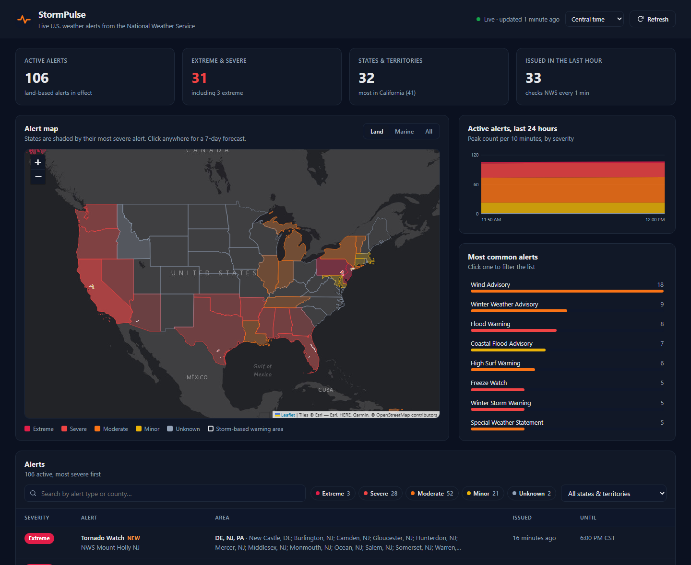
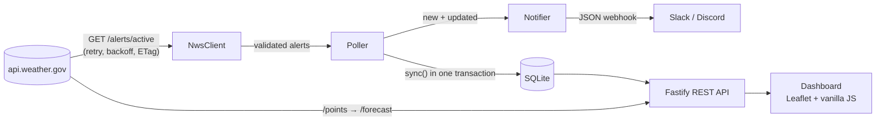

# StormPulse — Live U.S. Weather Alerts

A small Node.js service that watches the **National Weather Service** alerts feed around the clock,
stores what it sees in SQLite, works out what changed between polls, sends **Slack / Discord**
notifications for new severe alerts, and serves a live map dashboard.

Built with **Node.js 22+ (native TypeScript), Fastify, Zod, `node:sqlite` and Leaflet** — three runtime
dependencies, no build step.



## What it does

- **Polls `api.weather.gov`** every 2 minutes (configurable) for all active watches, warnings and advisories.
- **Detects changes** between polls: new alerts, *updates* to earlier alerts, and alerts that ended.
- **Notifies** a Slack or Discord webhook about new alerts that match your rules
  (minimum severity, states you care about, land vs. marine), with a per-poll cap.
- **Keeps history** so the dashboard can chart how many alerts were active over the last 24 hours.
- **Dashboard:** a U.S. map shaded by each state's most severe alert, storm-based warning polygons,
  KPIs, a trend chart, the most common alert types, and a searchable, filterable alert list
  with full NWS text. Click anywhere on the map for a **7-day forecast** for that spot.
- Times display in the viewer's time zone or any U.S. zone (Eastern, Central, Mountain, Arizona, Pacific, Alaska, Hawaii).
- Dark mode, keyboard support and a layout that works down to phone width.

## How it works



A poll goes like this:

1. **Fetch.** `NwsClient` sends the required `User-Agent`, times out after 15 s, and retries network errors,
   `429` and `5xx` with exponential backoff and jitter (honoring `Retry-After`). `4xx` errors fail fast.
2. **Skip if unchanged.** The feed returns an `ETag`. The client sends `If-None-Match`, and because the API
   currently answers with a full `200` anyway, it also compares the ETag itself — an unchanged feed is never
   parsed or written.
3. **Validate.** Zod checks each feature. One malformed alert is skipped and logged instead of failing the
   whole poll. UGC zone codes are mapped to state codes and classified as land or marine.
4. **Diff.** `diffAlerts()` compares the feed with the database. NWS publishes an update as a *new* alert id that
   references the one it replaces, so a new id pointing at a known alert counts as **updated**, not **new**.
   Ids that disappeared from the feed are marked **ended**.
5. **Notify.** The very first poll (empty database) is treated as a baseline and sends nothing — otherwise
   you'd get hundreds of messages on first boot. After a restart, the diff runs against the saved state, so
   alerts issued while the service was down still get reported. After that, matches are sorted by severity, capped, and posted. A failing
   webhook is logged and never stops polling.
6. **Record.** Each poll writes a row to `poll_runs` and a severity snapshot for the trend chart. Old history
   is pruned after `HISTORY_HOURS`.

The poller uses a `setTimeout` chain, not `setInterval`, so polls never overlap. A manual refresh joins
the poll already in flight instead of starting a second one. When the API keeps failing, the interval
backs off up to 8× and returns to normal after the next success.

## API

| Method | Path | Description |
|---|---|---|
| `GET` | `/api/alerts` | Active alerts. Query: `zone` (`land` default, `marine`, `all`), `area` (state code), `severity` (comma-separated), `q` (search), `limit` |
| `GET` | `/api/alerts/:id` | One alert, including ones that already ended |
| `GET` | `/api/stats` | Totals by severity, by state and by alert type, plus the last poll's status |
| `GET` | `/api/history` | Active-alert counts over time. Query: `hours` (default 24), `zone` |
| `GET` | `/api/forecast?lat=&lon=` | 7-day NWS forecast for a U.S. point, cached for 10 minutes |
| `GET` | `/api/health` | `200` while data is fresh, `503` once it's 3 poll intervals old — for uptime monitors |
| `POST` | `/api/poll` | Poll now. Needs `Authorization: Bearer <ADMIN_TOKEN>` when that's set; limited to once every 30 s |

Query strings are validated with JSON Schema, so bad input gets a `400` with a clear message.

```bash
curl "http://localhost:3000/api/alerts?area=TX&severity=Extreme,Severe"
```

## Run it locally

Requires **Node.js 22.18 or newer** (it runs the `.ts` files directly).

```bash
npm install
cp .env.example .env    # optional: set NWS_USER_AGENT, WEBHOOK_URL, NOTIFY_AREAS…
npm run dev             # http://localhost:3000, restarts on file changes
```

```bash
npm test                # 43 tests, node:test, no network access
npm run typecheck       # tsc --noEmit
```

### Docker

```bash
docker build -t stormpulse .
docker run -p 3000:3000 -v stormpulse-data:/data \
  -e NWS_USER_AGENT="StormPulse (you@example.com)" stormpulse
```

The image runs as a non-root user, keeps the database on the `/data` volume, and has a `HEALTHCHECK` on `/api/health`.

## Configuration

All settings come from environment variables (or `.env`) and are validated at startup —
a typo fails fast with a readable error instead of misbehaving later.

| Variable | Default | Description |
|---|---|---|
| `PORT` / `HOST` | `3000` / `127.0.0.1` | Where the server listens (`0.0.0.0` in Docker) |
| `NWS_USER_AGENT` | `StormPulse/1.0 (…)` | NWS asks every client to identify itself, ideally with contact info |
| `POLL_INTERVAL_SECONDS` | `120` | How often to check the feed (minimum 30) |
| `DB_PATH` | `data/stormpulse.db` | SQLite file |
| `HISTORY_HOURS` | `48` | How long to keep ended alerts, snapshots and poll logs |
| `WEBHOOK_URL` | — | Slack incoming webhook or Discord webhook. Empty = dry run (matches are only logged) |
| `NOTIFY_MIN_SEVERITY` | `Severe` | `Extreme`, `Severe`, `Moderate`, `Minor` or `Unknown` |
| `NOTIFY_AREAS` | — | State codes to watch, e.g. `TX,OK,KS`. Empty = the whole country |
| `NOTIFY_INCLUDE_MARINE` | `false` | Also notify about coastal and Great Lakes alerts |
| `NOTIFY_MAX_PER_POLL` | `5` | Cap per poll (max 10); the rest become "…and N more" |
| `PUBLIC_URL` | — | Dashboard URL; notifications then link straight to the alert |
| `ADMIN_TOKEN` | — | Protects `POST /api/poll`; the dashboard's Refresh button then just reloads data |
| `LOG_LEVEL` | `info` | Structured JSON logs (pino, via Fastify) |

## Project structure

```
src/
  index.ts          wiring, graceful shutdown
  config.ts         environment parsing and validation (Zod)
  nws/client.ts     HTTP client: timeouts, retries, ETag, forecast cache
  nws/schema.ts     payload validation, UGC → state mapping
  store.ts          SQLite schema, sync/diff, queries, snapshots
  poller.ts         scheduling, baseline handling, failure backoff
  notifier.ts       notification rules, Slack and Discord payloads
  server.ts         Fastify routes and static files
public/             dashboard (HTML, CSS, ES module; Leaflet from CDN with SRI)
test/               unit and HTTP tests with fake fetch, in-memory SQLite
```

## Design decisions

- **Few dependencies.** Node's own `fetch`, `node:sqlite`, test runner and TypeScript type stripping
  cover what used to take a dozen packages. The runtime needs only Fastify, `@fastify/static` and Zod.
- **SQLite over a hosted database.** One process, one file, transactional writes. The alert JSON is
  stored whole, with indexed columns next to it for filtering.
- **Untrusted input everywhere.** API payloads are validated, the forecast URL returned by `/points` is
  only followed if it stays on the NWS host, LIKE wildcards in search are escaped, and every string the
  dashboard renders is HTML-escaped.
- **Testable by injection.** `fetch`, `sleep` and `now` are passed in, so retries, backoff and time-based
  logic are tested quickly and without network access.

## Data and disclaimer

Alert and forecast data come from the [National Weather Service API](https://www.weather.gov/documentation/services-web-api)
(U.S. government work, public domain). State shapes: [us-atlas](https://github.com/topojson/us-atlas) (ISC).
Basemap tiles © Esri.

StormPulse is an independent portfolio project, not an official warning system.
For life-safety decisions, follow [weather.gov](https://www.weather.gov) and local authorities.

## License

[MIT](LICENSE)
